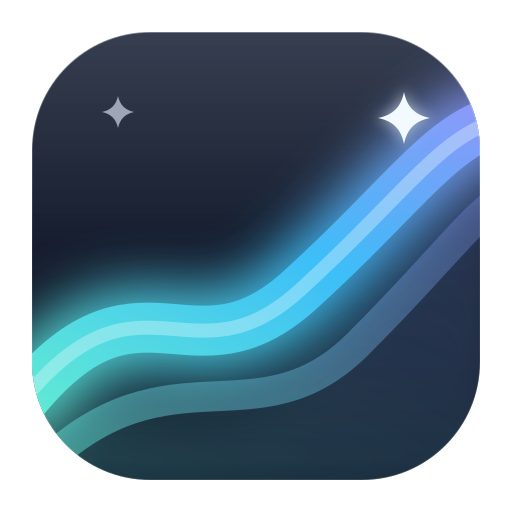

<div align="center">



# Polarys

**A modern, customizable floating dock and modular widget system for Windows 10 and Windows 11.**

*A polished continuation of [OpenTaskbar](https://github.com/alztrk/opentaskbar).*

[](https://github.com/qarlus/polarys)
[](https://github.com/qarlus/polarys)
[](https://github.com/qarlus/polarys)
[](LICENSE)
[](tests/OpenTaskbar.Tests)

<br />


<br />


</div>

---

## Overview

Polarys is a lightweight, macOS-inspired floating dock and taskbar replacement for Windows 10 and Windows 11. Built with pure WPF vector rendering, it delivers high performance, fluid magnification, live window thumbnail previews, modular hardware and media widgets, and foolproof native taskbar recovery.

---

## Key Features

### Optical Glass Dock
- **Aurora Visual Language:** Dark (Midnight Obsidian) and Light glass materials with top specular sheen, 1px optical bevel, and soft ambient drop shadows.
- **Dock Edge Placement:** Position the dock at the Bottom, Left, or Right edge of your primary screen, with independent alignment (Center, Left, Right, or Full-Width).
- **Size and Continuous Scale:** Choose between Compact (48 DIP), Medium (58 DIP), and Large (66 DIP) presets, or fine-tune scale from 75% to 150% with the continuous slider.
- **Surface Opacity:** Adjust background glass opacity between 60% and 100% with immediate real-time preview.
- **Two-Sided Dock Resizing:** Drag either outer border to narrow or expand the dock. Overflow is smoothly handled via hidden horizontal scrolling (Shift/Ctrl + Wheel or middle-click panning).

### Theme Packs
- **Theme Packs:** Restyle the dock with six bundled themes installed in `%LOCALAPPDATA%\OpenTaskbar\Themes` on first launch, or add your own theme packs there. Select them in Settings → Appearance → Theme.
- **Languages:** The first launch follows the Windows display language when Polarys has a translation for it. Choose a language in Settings → Appearance; see [docs/localization.md](docs/localization.md) to add another locale.
- **Icon Packs:** Replace app, Start button and Recycle Bin icons; match by executable name, full path, Store app ID, or simply name a file after the executable (`firefox.png`).
- **Fallback Plates:** Apps without a pack image are placed on a Leaf, Petal, Rounded, or Circle plate so the whole dock matches.
- **Widget Packs:** Replace design tokens (colors, gradients, corner radii, sizes, fonts) for the dock, widgets, menus, and Settings. See [docs/themes.md](docs/themes.md).
- **Prism Theme:** A ready-made theme in [themes/prism](themes/prism) with category icons on lit squircle plates and a graphite, violet-accented style. No application logos; duotone glyphs from Phosphor (MIT).

### Interaction and Motion
- **Continuous Fisheye Magnification:** Smooth parabolic wave magnification that expands icons upward into the transparent headroom without clipping or layout shifts.
- **Launch Feedback:** Tactile vertical launch bounce animation on application click.
- **Drag-and-Drop:** Drag applications directly onto the dock to pin, reorder on the fly, or drag out to unpin.

### Intelligent Window Management
- **Live DWM Thumbnails:** Interactive live window thumbnail previews with window titles and close buttons.
- **Native Jump Lists:** Right-click any application to open its native Windows Jump List with pinned tasks and recent files.
- **Foreground Highlighting:** Active foreground windows are clearly distinguished with illuminated accent capsules, independent of keyboard focus.
- **Packaged App Icons:** Running Store and packaged apps without executable icon resources show their Start menu icon. Apps hosted by ApplicationFrameHost share one dock cell, which shows the icon of the topmost hosted app.
- **Multi-Monitor Docks:** Optional secondary docks for multi-monitor setups.

### Smart Auto-Hide (IntelliHide)
- **Three Auto-Hide Modes:** Disabled (always visible), Smart (IntelliHide), and Always (hidden until edge hover).
- **IntelliHide Logic:** The dock stays visible on the desktop and behind non-overlapping windows. When an active window overlaps the dock region, the dock smoothly slides off-screen.
- **Fullscreen Detection:** Automatically yields and hides when full-screen applications, borderless games, or browser videos are playing.

### Modular Widget System
- **Real-Time Hardware Meters:** CPU usage, RAM usage, GPU usage, GPU temperature (NVIDIA), and CPU temperature rings with customizable thresholds.
- **Media Controls:** Now Playing track information, artist metadata, track seek bar, and volume slider.
- **Clock, Calendar and Weather:** Unified date and time capsule with detailed optical glass weather and multi-day forecast flyout.
- **Quick Settings and Connectivity:** Network status, Bluetooth toggle, and audio output device selector.
- **Productivity Widgets:** Focus Pomodoro timer, Stopwatch, Countdown timer, Storage drive usage, and Day Progress bar.
- **System Tray Management:** Background tray apps manager with window restore and confirmed process termination.
- **Interactive Catalog:** Built-in widget catalog with live previews and expandable configuration drawers with instant auto-save.

### Built-in Launcher and Extras
- **Spotlight Launcher (`Alt + Space`):** Quick keyboard launcher for applications, files, system settings, and inline math calculations.
- **Folder Stacks:** Quick access to folders (such as Downloads) with 2x2 miniature icon previews.
- **Recycle Bin Integration:** Live recycle bin icon supporting drag-and-drop file deletion and one-click emptying.
- **Dock Menu:** Right-click the dock for the launcher, folder stacks, profiles, Task Manager, update checks, and settings.

### Foolproof Taskbar Recovery
- **Zero Risk:** State journaling records every taskbar replacement action. On exit, system shutdown, or unexpected termination, Polarys automatically restores the native Windows taskbar.

---

## Visual Showcase

<div align="center">

| Settings Dashboard | Interactive Widget Gallery |
| :---: | :---: |
|  |  |

</div>

---

## Keyboard Shortcuts

| Shortcut | Description |
| :--- | :--- |
| `Alt + Space` | Open Spotlight Quick Launcher |
| `Shift + Mouse Wheel` | Scroll dock contents horizontally |
| `Ctrl + Mouse Wheel` | Scroll dock contents horizontally (high precision) |
| `Middle Click + Drag` | Pan overflowing dock contents |
| `Alt + F4` | Close window preview card |
| `Esc` | Close active flyout, stack, or launcher |

---

## Requirements

- **Operating System:** Windows 10 (version 2004 / build 19041+) or Windows 11 (x64)
- **Runtime:** .NET 10 Desktop Runtime (included in self-contained portable releases)

---

## Getting Started

### Portable Release

Download `OpenTaskbar.exe` from [GitHub Releases](https://github.com/qarlus/polarys/releases) and launch it directly. No installer or administrator privileges required.

### Build from Source

```powershell
# Clone the repository
git clone https://github.com/qarlus/polarys.git
cd polarys

# Run directly from source
dotnet run --project OpenTaskbar.csproj

# Run in preview mode with Settings window open (keeps Windows taskbar visible)
dotnet run --project OpenTaskbar.csproj -- --preview --settings

# Build self-contained portable executable (outputs to dist\OpenTaskbar.exe)
powershell -ExecutionPolicy Bypass -File ".\scripts\publish-portable.ps1"

# Run automated behavior and visual verification tests
dotnet run --project tests/OpenTaskbar.Tests/OpenTaskbar.Tests.csproj
```

---

## Configuration

User preferences, pinned item order, and widget configurations are stored locally in `%LOCALAPPDATA%\OpenTaskbar\`:

- `settings.json` : User preferences, dock scaling, pinned applications, and active widgets.
- `taskbar-state.txt` : Native Windows taskbar state recovery journal.
- `log.txt` : Diagnostic and operational log.
- `Themes\` : Theme packs (icon and widget packs). See [docs/themes.md](docs/themes.md).

---

## Design System

For in-depth documentation on the Polarys design tokens, materials, typography, and layout metrics, see [Design/README.md](Design/README.md).

---

## License

Distributed under the MIT License. See [LICENSE](LICENSE) for details.
